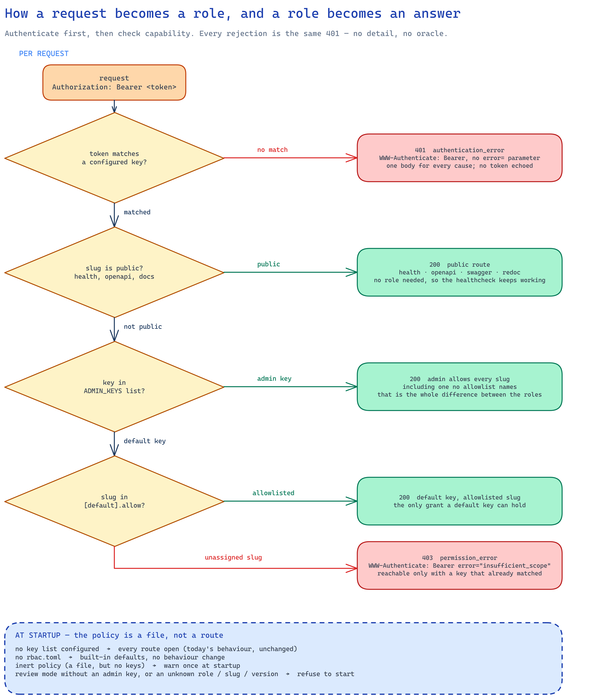

# Two roles and an allowlist file, not a permission system

**Status:** accepted (implemented)
**Date:** 2026-11-19
**Author:** marcus
**Deciders:** marcus
**Refs:** ADR-0017, ADR-0018, [`../../src/kokoro_tone/access.py`](../../src/kokoro_tone/access.py),
[`../../src/kokoro_tone/routes.py`](../../src/kokoro_tone/routes.py),
[`../../src/kokoro_tone/settings.py`](../../src/kokoro_tone/settings.py),
[`../configuration.md`](../configuration.md)

## Context

Authentication today is one flat list. `require_auth` compares the bearer token
against `KOKORO_TONE_API_KEYS` / `KOKORO_TONE_API_KEY` with
`secrets.compare_digest` and no early exit, so timing cannot reveal which key
matched; every key that matches is worth exactly as much as every other. Two
write endpoints add a second, unrelated gate - `X-Pronunciation-Key` against
`PRONUNCIATION_WRITE_KEY` - which proves possession of another secret but says
nothing about *what* the caller may do.

ADR-0017 needs something this cannot express: a caller who may propose a
pronunciation must not be able to approve it. That is a permission question with
exactly two answers, and it is the only one this service has. Building a
permission model with users, tokens, scopes and a store would be a second
identity system for one distinction.

The population is small and static: the Morning Glory episode renderer, the
podcast script CLI, an operator with `curl`. There is no identity provider, no
user directory and no per-user state anywhere in the service. Whatever the
answer is, it has to be a file and a pair of environment variables, deployed the
same way as the lexicon.

## Decision

1. **There are two roles and no more: `default` and `admin`.** A caller that
   needs finer distinction gets another key, not another role.
2. **A slug is an operation id.** The authorisation unit is the OpenAPI
   `operationId` (ADR-0018), not the path, so `GET` and `DELETE` on the same
   path are separately grantable and a path parameter cannot confuse the match.
3. **`default` denies.** A default key may call only the slugs named in
   `[default].allow`. A slug no list names is admin-only.
4. **`admin` allows.** An admin key may call every slug, including one no list
   names. That is the whole difference between the roles, and it is why an
   unassigned slug fails closed for `default` without needing an entry of its
   own.
5. **Keys stay CSV in the environment, parsed by the existing `_token_list`.**
   `KOKORO_TONE_API_KEYS` / `KOKORO_TONE_API_KEY` are `default`.
   `KOKORO_TONE_ADMIN_KEYS` / `KOKORO_TONE_ADMIN_KEY` are new and are `admin`.
   The admin list is checked first, so a token present in both is `admin`.
6. **The policy is one TOML file** at `KOKORO_TONE_RBAC`, defaulting to
   `/etc/kokoro-tone/rbac.toml`:

   ```toml
   version = 1

   [default]
   allow = [
     "compileScript",
     "createPronunciation",
     "createSpeech",
     "deletePronunciation",
     "getHealth",
     "listModels",
     "listPronunciations",
     "listVoices",
   ]
   ```

   There is no admin key list and no "open" list in the file. The admin role is
   defined by having an admin key; the public set is defined in code (rule 8).
   The list above is the generated template, and it is what a `default` key can
   already do at the release that implemented this record: read, render, list,
   propose, delete and dry-run, unchanged from the flat key list it replaces.
   The narrowing to read/render/list/propose - with deciding, deleting and
   auditioning admin-only - arrives with ADR-0017 and ADR-0018, which add that
   review half. Until then this record's promise is rule 7: adding roles must
   not take an operation away from an existing caller.
7. **No policy file means the built-in defaults**, and those defaults change no
   behaviour of their own: every slug the deployment can call with a bearer
   today stays callable by that bearer. A deployment opts into a narrower policy
   by writing the file. The template is generated from the code defaults into
   `lexicon/rbac.example.toml` so the two cannot drift quietly. The one change
   that does land with auth is rule 14's retirement of the write key.
8. **`PUBLIC_SLUGS` is code, not configuration:** `getHealth`, `openapi`,
   `swagger_ui_html`, `redoc_html`. The compose healthcheck calls `/health` with
   no credential, and a deployment that could remove `openapi` from this set
   would break its own documentation and its own healthcheck. Public is a
   property of the contract, so it is not a deployment choice.
9. **No keys configured means no authentication**, exactly as today: with both
   key lists empty, every slug is allowed to everyone and the policy file is
   inert, which logs one warning at startup. Turning auth on is adding a key,
   not editing the policy.
10. **A configuration error refuses to start.** An unknown role table, an
    unknown slug, an unknown `version`, or `review` mode without an admin key
    fails at boot with a message naming the offending line. A typo in a policy
    file must not silently widen or narrow access at request time.
11. **Every 401 is the same 401.** `WWW-Authenticate: Bearer` with no `error=`
    parameter, the body
    `{"error":{"message":"invalid or missing bearer token","type":"authentication_error","code":"invalid_api_key"}}`,
    and no mention of whether a token was absent, malformed or unknown. The
    reason is logged with the path and slug only, never the presented token, not
    even a prefix.
12. **A 403 names the scope, because it can only be reached with a recognised
    key:** `WWW-Authenticate: Bearer error="insufficient_scope"` and
    `code: insufficient_scope`. 403 rather than 404 for a slug the key may not
    use, because the spec is published and hiding routes only costs debugging
    time.
13. **Authentication is checked before authorisation, always.** A default key on
    an admin slug is 403, never 401.
14. **`PRONUNCIATION_WRITE_KEY` retires with this change.** It existed because
    there was one gate and the write routes needed a second; with roles, the
    write routes are granted by slug like everything else. ADR-0018 carries the
    breaking note.



*Diagram: [source](../diagrams/rbac-resolution.excalidraw). The order is the security
property: authenticate to a role first, check capability second, and let only a
recognised key reach a 403.*

## Considered options

**Grant per route in code, with no configuration.** Rejected: a deployment that
wants to widen or narrow what its episode renderer may do would need a rebuild,
and the grant would live nowhere an operator reads.

**A role per key, encoded in the key string (`token:admin`).** Rejected: it puts
the role inside the secret, so rotating a role means rotating a key, and a
mistyped suffix becomes a parse error at authentication time instead of a
startup error.

**OAuth2 scopes or a signed token.** Rejected: there is no issuer, no audience
and no user directory. Static keys are the whole population; a token format
would add signing, rotation and validation code to express two values.

**Put the public slugs in the config file as an `open` list.** Rejected: it
invites the one edit that breaks the healthcheck, and "public" is documentation
of the service's contract rather than a deployment knob.

**Keep `X-Pronunciation-Key` as the second gate.** Rejected: it proves a second
secret without saying which routes it unlocks, so it cannot express "may propose
but not approve" (ADR-0017) and it splits one permission decision across two
mechanisms that can disagree.

**Allowlist by path prefix.** Rejected: `/v1/pronunciations/{id}` is three
operations with three different grants, and a path parameter is not a stable
name for a permission. The operation id is.

## Consequences

- A route added without a mention in `[default].allow` is admin-only. That is the
  safe default and the most likely operational surprise: a new feature is
  invisible to the episode renderer until the policy file is updated.
- The allowlist is keyed by operation id, so renaming an operation (ADR-0018
  says names are part of the contract) is a configuration change too. The spec
  test and the generated template are what stop that becoming a silent outage.
- Two key lists to rotate instead of one, and an admin key that unlocks the write
  surface. It now has to be protected like a credential that can rewrite what
  every listener hears.
- Uniform 401s make a legitimate client's "wrong key or no key?" question harder
  to answer. The logs answer it, at the cost of an operator looking.
- The policy is inert until keys exist. A deployment that enables RBAC but
  forgets `KOKORO_TONE_API_KEYS` still lets everything through; the startup
  warning is the only signal, and it is easy to miss in a log.
- Rejecting an unknown slug at boot means the policy file and the code version
  must be deployed together, which rules out rolling the config forward.

## Verification

Implemented in `src/kokoro_tone/access.py` and `tests/test_access.py`. These
hold:

- `KOKORO_TONE_RBAC` unset, keys unset: every current route answers as it does
  today, and a policy file that does exist is inert with one startup warning.
- `KOKORO_TONE_RBAC` unset, `KOKORO_TONE_API_KEYS` set: every route that
  `getHealth` and the docs do not own requires the key.
- A default key on a slug the policy does not name returns 403 with
  `error="insufficient_scope"`. `deletePronunciation` is the named example once
  ADR-0017/0018 narrow the policy; at this release the built-in policy names it,
  so the test uses a file that names only `listModels`.
- An admin key on any slug returns the route's usual status, including a slug no
  allowlist names.
- The generated template (`lexicon/rbac.example.toml`) allows a default key
  every slug it can call today; its contents equal `access.template()`, so it
  cannot drift from `DEFAULT_ALLOW`.
- A policy naming one slug under `[default].allow` grants exactly that route and
  nothing else.
- A policy containing `version = 2`, an unknown table, an unknown key or an
  unknown slug fails at startup, naming the file and the offending value.
- The body of a 401 is identical for no header, a malformed header, an unknown
  token and a token from the wrong deployment.

Deferred with ADR-0017: the `review`-mode-without-an-admin-key startup check,
and the admin-only `updatePronunciation` / `retrievePronunciationAudio` slugs,
which do not exist until that record lands. The operation ids in this record are
already the ones ADR-0018's table uses, so its path changes do not rename a
permission.
