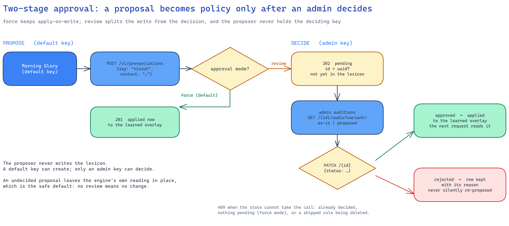

# Two-stage approval: a proposal becomes policy only after an admin decides

**Status:** proposed
**Date:** 2026-11-19
**Author:** marcus
**Deciders:** marcus
**Refs:** ADR-0016, ADR-0018, [`../pronunciation.md`](../pronunciation.md),
[`../../src/kokoro_tone/routes.py`](../../src/kokoro_tone/routes.py),
[`../../lexicon/learned/learned.json`](../../lexicon/learned/learned.json)

## Context

The learned overlay is written straight through. `POST /v1/pronunciations/learn`
takes `{word, say, sense}`, validates the character set, appends a rule and the
next request reads it. The only gate is optional (`PRONUNCIATION_WRITE_KEY`) and
only proves that the caller holds a secret.

That is the right shape for an operator with `curl` who has just heard the
output. It is the wrong shape for a pipeline. Morning Glory renders an episode
from a script, hears a name mispronounced, and writes a respelling; every
listener of the next render hears that respelling, and nobody checked it. The
current learned overlay is 19 rows, 18 of them carrying uppercase stress markers
(`MEL-bun`, `NISS-uh`, `al-buh-NEEZ`), which is exactly the shape of an
unreviewed guess: a caller has guessed where the stress falls and written the
guess into policy.

A wrong reading is cheap to produce and expensive to publish - it is in the
audio, not in a log. Review is therefore worth one round trip, but only for
deployments that ask for it: an operator editing their own overlay should not
have to approve themselves.

## Decision

1. **Approval mode is deployment configuration:** `PRONUNCIATION_APPROVAL` is
   `force` (default) or `review`. `force` is today's behaviour and stays the
   default, so an upgrade changes nothing until a deployment opts in.
2. **`force` applies on write.** `POST /v1/pronunciations` writes the learned
   overlay and answers `201`.
3. **`review` splits the write from the decision.** The same `POST` records a
   proposal and answers `202` with its id. Nothing enters the learned overlay
   until it is approved, so an unreviewed proposal leaves the engine's own
   reading in place.
4. **A proposal is a row, not a queue file.** Fields: `id` (UUIDv7, so creation
   order sorts lexically), `status` (`pending`, `approved`, `rejected`), `word`,
   `say`, `sense`, `context`, `created_at`, `created_by_role`, and after a
   decision `decided_at`, `decided_by_role`, `reason`. The row survives the
   decision; a rejection keeps its reason so the same suggestion is not made
   again in ignorance.
5. **The queue is read oldest first**, `GET /v1/pronunciations?status=pending`,
   because it is a work queue and the oldest undecided proposal is the one
   holding up a name.
6. **Only `admin` may decide.** `PATCH /v1/pronunciations/{id}` with
   `{"status": "approved"}` or `{"status": "rejected"}` applies or refuses the
   proposal. `DELETE /v1/pronunciations/{id}` removes a row. A `default` key
   gets 403 on both (ADR-0016).
7. **The decision is made on sound.** `GET /v1/pronunciations/{id}/audio` with
   `variant=as-is` or `variant=proposed` renders the proposal's own context
   sentence with and without the new reading. Two takes of the same sentence is
   the only honest way to judge a respelling; approving from spelling is what
   produced the uppercase markers.
8. **State conflicts are 409, not 403.** `invalid_transition` when the row is
   already decided, `not_pending` when a decision arrives in `force` mode (there
   is nothing pending), `immutable_rule` when the target is a shipped default
   rather than a learned row. An admin hitting any of them gets 409 too - the
   state, not the permission, is the problem.
9. **`review` refuses to start without an admin key.** A review queue nobody can
   drain is a service that silently stops learning.
10. **An uppercase run in `say` is a warning in `force` and a `400` in `review`.**
    Uppercase is the signal a proposer is guessing stress. In `force` the guess
    is logged and applied, because the caller is the operator; in `review` it is
    rejected before it reaches the queue, because the proposer is not the
    decider and the guess is the thing under review.
11. **The proposal carries no identity.** There is no user directory
    (ADR-0016), so the row records the role that proposed it, not a person. The
    audit trail this buys is "a default key proposed it, an admin key decided
    it", which is the distinction the design is for.

*Diagram: [source](../diagrams/approval-lifecycle.excalidraw). The proposer
never writes the lexicon; the queue is the decider's inbox, and the audition is
the step that makes the decision about sound rather than spelling.*

## Considered options

**A dry-run flag on `learn` instead of a queue.** Rejected: the caller would
still be the one who applies it, so the safety property - a different key makes
the final decision - would not hold, and the proposal would not survive the
request that made it.

**Approve by timeout:** a pending proposal applies itself after N hours unless
rejected. Rejected: it turns inattention into policy, which is the failure this
record exists to prevent.

**Approve out of band (chat, email) and apply with `curl`.** Rejected: nothing
would record what was proposed, so the decision would not be auditable, and the
reviewer would have to reconstruct the context by hand.

**Per-word trust: auto-approve after N approvals.** Rejected as unearned. The
population is one proposer and one reviewer; a reputation rule would be tuned on
no evidence, and the failure mode (a trusted word approved unreviewed) is the
same one being fixed.

**A second service for the review queue.** Rejected: it would need the same
lexicon, the same renderer and the same auth, and the queue is one small file
next to `learned.json`.

**Make `review` the default.** Rejected: the default must not change behaviour
on upgrade, and a single-operator deployment would be approving itself through
two keys for no gain. The mode is opt-in and documented.

## Consequences

- A proposal is now two round trips and a queue to drain. A deployment that
  turns `review` on and does not watch the queue stops learning new names, which
  is safe but silent unless the pending count is watched.
- A second file appears beside `learned.json` - the proposal store - with its own
  atomic write, its own size cap and its own corruption path. Two files that must
  agree is more than one.
- The row store is not the learned overlay: approving copies a rule across. A bug
  there can lose an approval or apply it twice, so the write has to be idempotent
  per id.
- UUIDv7 is not in the container's Python (3.12 has no `uuid.uuid7`), so a small
  local generator is required. Ordering is the reason for the choice; a
  timestamp column would do the same job with more code.
- `review` mode is only as good as the audition. If a reviewer approves from
  spelling anyway, the queue has added latency and no safety.
- The learned overlay's existing 18 uppercase respellings are not touched by this
  record. They are already policy; purging them is a data change, not an
  architectural one.

## Verification

Not implemented. When it lands, these hold:

- `PRONUNCIATION_APPROVAL` unset: `POST /v1/pronunciations` writes the overlay,
  answers `201`, and the next render uses the new reading.
- `PRONUNCIATION_APPROVAL=review`: the same call answers `202` with a UUIDv7, and
  the next render is unchanged.
- Approving that id with an admin key makes the next render use the new reading;
  rejecting it with a reason leaves the render unchanged and the row present.
- `GET /v1/pronunciations?status=pending` lists proposals oldest first.
- A default key on `PATCH` or `DELETE` returns 403 with `insufficient_scope`.
- A second `PATCH` on a decided id returns 409 `invalid_transition`; a `PATCH` in
  `force` mode returns 409 `not_pending`; deleting a shipped default returns 409
  `immutable_rule`.
- `review` with no `KOKORO_TONE_ADMIN_KEYS` exits non-zero at startup.
- `{"say": "NISSUH"}` is a logged warning in `force` and a `400` in `review`.
- `GET /v1/pronunciations/{id}/audio?variant=proposed` returns audio for the
  proposal's context sentence, and `variant=as-is` returns the same sentence
  without it.
