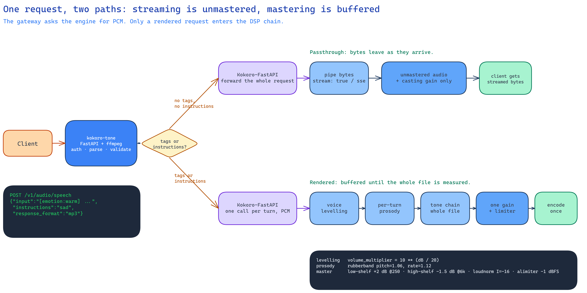

# Diagrams

The source `.excalidraw` file is authoritative; the rendered `.png` is the
display copy. Both are committed, and every diagram is embedded from the
document that owns it.

## Placement and naming

- One hero diagram per document; add another only where a flow is hard to
  explain in prose.
- Name the pair after the section it illustrates, in kebab-case:
  `<topic>.excalidraw` + `<topic>.png`.
- Keep the table or prose summary that the diagram illustrates. Tables are the
  lookup surface; diagrams carry the argument.
- Do not add version suffixes. Replace the pair in place and let git hold the
  history.

## Embedding

Embed the PNG with a relative path and descriptive alt text. Link the source in
the caption so a reader can edit it. From a document in `docs/`, the image path
is `diagrams/<topic>.png`; from the README it is `docs/diagrams/<topic>.png`.

```markdown


*Diagram: [source](request-lifecycle.excalidraw). The two paths are the whole trade-off: streaming is unmastered, mastering is buffered.*
```

The caption states the takeaway, not just the title.

## Visual language

- Use rectangles for services and processes, diamonds for decisions, and
  dashed borders for boundaries.
- Label arrows with the real protocol, port or stage, not generic "requests".
- Use the semantic colours from the `excalidraw-diagram` skill's palette. Do not
  invent colours per diagram.
- Include concrete evidence: real endpoints, environment keys, filter values,
  headers or file paths.

## Maintenance

1. Edit the `.excalidraw` source.
2. Render it with the `excalidraw-diagram` skill's `references/render.sh`.
3. Inspect the render for clipping, overlap and misrouted arrows.
4. Update the PNG, the embedding document and this registry in the same change.
5. Remove or update orphaned diagrams. Every committed diagram should be
   referenced from a document.

## Registry

| Diagram | Type | Source | Embedded in |
|---|---|---|---|
| Request lifecycle | Flow | `request-lifecycle.excalidraw` | `README.md` § How it works |
| Audio pipeline | Pipeline | `audio-pipeline.excalidraw` | `docs/audio.md` § Tone chain and mastering |
| Pronunciation resolution | Flow / precedence | `pronunciation-resolution.excalidraw` | `docs/pronunciation.md` intro |
| Observability pipelines | Data flow | `observability-pipelines.excalidraw` | `docs/observability.md` intro |
