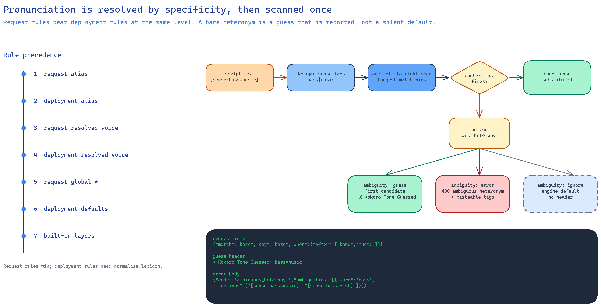

# Pronunciation and normalisation

How a word in the script becomes a sound the engine can say: request rules,
the deployment lexicon, heteronym senses, and the opt-in digit and acronym
layers. Both `pronunciations` and `normalise` are optional; a request without
them behaves exactly as before.

This is the stable part of the gateway. It is deterministic, engine-independent
and usable on its own:

```bash
printf 'The bass player read HTML at 15%%.\n' \
  | python -m kokoro_tone.script_cli --lexicon lexicon/lexicon.json --normalise --json
```

The HTTP endpoint and the CLI share `script.compile_script`; neither adds a
second interpretation of the text.



*Diagram: [source](diagrams/pronunciation-resolution.excalidraw). The ladder
decides which rule wins; the scan decides what the listener hears. A bare
heteronym is guessed and reported rather than silently passed through.*

## Word mapping and normalisation

A script is easier to keep readable when the engine-specific spellings live in
data rather than in the prose. `pronunciations` maps words to the form the
engine should say; `normalise` turns on the built-in digit and acronym layers.

### `pronunciations`

A map is the shorthand:

```json
{"input": "The bass player.", "pronunciations": {"bass": "base"}}
```

A list adds context, so words spelt the same can be told apart:

```json
"pronunciations": [
  {"match": "bass", "say": "base", "when": {"after": ["band", "music", "plays"]}},
  {"match": "bass", "say": "bass"}
]
```

Each rule takes `match`, `say`, and optionally `when`, `case_sensitive`
(default false) and `whole_word` (default true). `when` accepts `before`,
`after` and `within`: the listed words are literal, case-insensitive and
whole-word, `before`/`after` are OR within a list and AND across lists. An empty
`say` deletes the match.

The window needs no configuration. A `before` cue looks back two words, because
it is a syntactic signal: "they record" is a verb, but "I think the record" is a
noun. An `after` cue looks to the end of the sentence, because it is a lexical
signal: "bass in the band" is music wherever "band" falls. A cue never crosses a
sentence boundary. `within` overrides both sides with an explicit count.

Rules are tried longest-first at each position, ties go to the earlier rule,
and an emitted replacement is never re-scanned. `[` and `]` are rejected, so a
replacement cannot inject markup. `pronunciations` applies even when
`normalise` is off.

### Heteronyms: forcing a sense

A word spelt the same but spoken differently needs its sense named, because the
engine's own tagger is unreliable on them. Name it with a tag, the same grammar
as `[voice:]` and `[emotion:]`:

```text
He plays [sense:bass=music] in the band. A [sense:bass=fish] swam past.
Two [sense:does=noun] grazed. It [sense:does=verb] work.
```

The tag is replaced by the checked respelling before synthesis, so the tag
itself is never spoken:

```text
He plays base in the band. A bas swam past.
Two dohz grazed. It duz work.
```

An unknown sense is a `400`, not text read aloud: `[sense:bass=jazz]` has no
rule, so the gateway says so instead of reading "bass jazz".

The 100 heteronyms live in `lexicon/lexicon.json` as rules, most used word
first: two marker rules (`word|sense`) and, where context can decide it, one or
more bare rules. There is no separate table and no build step - the file the
gateway loads is the file you edit.

#### Deciding a bare word

A script does not have to mark every occurrence. Where the surrounding words are
a reliable signal, a bare word is voiced from its context rules:

| Word | Cue | Chosen |
|---|---|---|
| `record` | `the` before | noun, `rek-awd` |
| `record` | `finance` before | noun, `rek-awd` |
| `record` | `to` before | verb, `rih-kawd` |
| `separate` | a number or determiner before | adjective, `sep-uh-rut` |
| `live` | a determiner before | adjective, `lyve` |
| `bass` | `band`, `music` after | music, `base` |
| `bass` | `fish`, `swam` after | fish, `bas` |
| `minute` | `detail` after | adjective, `my-newt` |
| `minute` | `the` before | noun, `min-it` |

Three rules govern the decision:

1. **Context first.** When a bare rule's cue fires, it decides. When none does,
   the word is reported as a guess (see below) rather than passed through
   silently.
2. **Most used word first.** Rules are ordered by frequency, because the scanner
   takes the first rule whose context is satisfied when two rules cover the same
   span. Within a word, the sense with the more specific rule is tested first,
   and the first candidate is what a guess picks.
3. **Some words are marker-only.** `stress` pairs (`digest`, `increase`,
   `transfer`, …) differ only in stress, which no respelling can split, so they
   have marker rules and no bare rules. They are never guessed or reported.

A bare rule's `when` is `before` / `after` word lists, and each side becomes its
own rule: `when` is AND across lists, so a noun cue before and a verb cue after
in one rule would require both. No window is written: a `before` cue looks back
two words and an `after` cue looks to the end of the sentence.

The decision covers the base form only. `records`, `recorded` and `recording`
need a tag or a per-request rule, because appending an inflection to a phonetic
respelling is not reliable.

A per-alias map keys rules by the voice or alias token, with `*` for the
global part:

```json
"voice": {"id": "narrator", "narrator": "bm_lewis", "guest": "am_michael"},
"pronunciations": {
  "*": {"Lachie": "Locky"},
  "narrator": [{"match": "bass", "say": "base"}],
  "guest": [{"match": "bass", "say": "fish"}]
}
```

#### When the context cannot tell

Some sentences give the context rules nothing to work with - *The bass was loud* is
music or fish, and no nearby word says which. The gateway does not fail and does
not stay silent: it picks the first candidate and says what it assumed.

```bash
curl -sSD - http://kokoro-tone:8000/v1/audio/speech \
  -H "Authorization: Bearer $KOKORO_TONE_API_KEY" \
  -H 'Content-Type: application/json' \
  -d '{"input":"The bass was loud."}' -o out.mp3
# HTTP/1.1 200 OK
# x-kokoro-tone-guessed: bass=music
```

The audio says "base", and the header names the word and the sense chosen. A
pipeline can log it, or rewrite the script with a tag and re-render. The guess
is the first candidate in the rule order, which is the most-used word first and
the authored sense order within a word.

| `ambiguity` | Behaviour |
|---|---|
| `guess` (default) | first candidate, render, `X-Kokoro-Tone-Guessed` header |
| `ignore` | leave the engine's own default, no header |
| `error` | `400` with the tags to choose from; nothing rendered |

`error` is for a pipeline that would rather stop than ship a guess. The body
carries the exact tag to paste in:

```json
{
  "error": {
    "message": "1 word needs a sense tag: bass ([sense:bass=music], [sense:bass=fish]). Write the tag in the text, or add a pronunciation rule for it.",
    "type": "invalid_request_error",
    "param": "input",
    "code": "ambiguous_heteronym",
    "ambiguities": [
      {"word": "bass", "offset": 4,
       "options": ["[sense:bass=music]", "[sense:bass=fish]"],
       "says": ["base", "bas"],
       "chosen": "bass=music"}
    ]
  }
}
```

Every occurrence is reported with its own offset - within the turn that contains
it, so for an array `input` the offset is relative to that turn's text.

A word only counts as ambiguous when its senses have different respellings. The
`stress` rows are never guessed or reported, because a tag cannot change them
either.

### `normalise`

`normalise: true` enables the built-in layers; an object selects them:

```json
"normalise": {"lexicon": true, "acronyms": true, "numbers": true}
```

- `numbers` - Australian English digits: `3,913` → "three thousand nine hundred
  and thirteen", `0.43` → "nought point four three", `15%` → "fifteen per
  cent", `10-15` → "ten to fifteen", `21st` → "twenty-first". Years stay as
  digits. Model names, versions, dates, IPs and compound tokens (`MP3`, `H264`,
  `v2`, `Kokoro-82M`, `2.1.0`, `2026-11-11`) are left alone.
- `acronyms` - a table entry wins (`SQL` → "sequel"); otherwise a 2–6 letter
  uppercase token is spelled letter by letter (`HTML` → "Aitch Tee Emm Ell").
  Single letters, tokens touching digits, and the protect list (`IT`, `NO`,
  `YES` by default) are skipped.
- `lexicon` - the deployment file's rules, per-voice sets, letters and locale.

`normalise: true` uses the `NORMALISE_*` layer defaults; an object turns on
exactly its keys.

### Per-voice sets and server aliases

The deployment file is a collection of sets plus server aliases:

```json
{
  "defaults": {"rules": {"Lachie": "Locky"}, "protect": ["IT"]},
  "voices": {
    "bm_lewis": {"letters": {"A": "Aigh"}, "locale": "en-GB"},
    "am_michael": {"locale": "en-US"}
  },
  "aliases": {"id": "bm_lewis", "narrator": "bm_lewis"}
}
```

`defaults` and each `voices.<name>` share one shape: `rules`, `acronyms`,
`protect`, `letters`, `locale`. `aliases` ships empty; an `id` entry sets the
server default voice, and the request `voice` map sits on top of it.

The shipped file is the defaults. A deployment can add an overlay
(`PRONUNCIATION_OVERRIDES`, `custom.json` beside it); the gateway composes the
two in memory. Overlay rules are tried before default rules, overlay acronyms
and letters win, `protect` is the union, and an overlay `locale` wins. A missing
overlay is normal. Request rules still sit on top of the composed result.

The lookup for a turn is: request set for the token as written → deployment set
for that token → request set for the resolved voice → deployment set for the
resolved voice → request global (`*`) → deployment `defaults` → built-in. The
"deployment" set is the shipped defaults with the user overlay already composed
in. So `[voice:bm_lewis]` mid-script uses that voice's set, and an alias inherits
the underlying voice's set.

The file is verified at load: file-level problems ignore the file, entry-level
problems skip that entry and keep the rest, and everything is logged to stderr.
It is reloaded when its mtime or size changes, so a word can be fixed without a
restart. A missing file is not a problem. See
[`lexicon/README.md`](../lexicon/README.md) for the schema.

